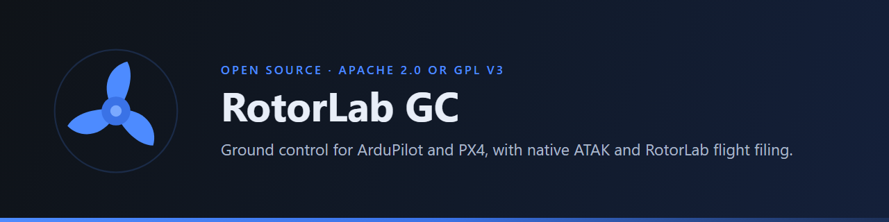
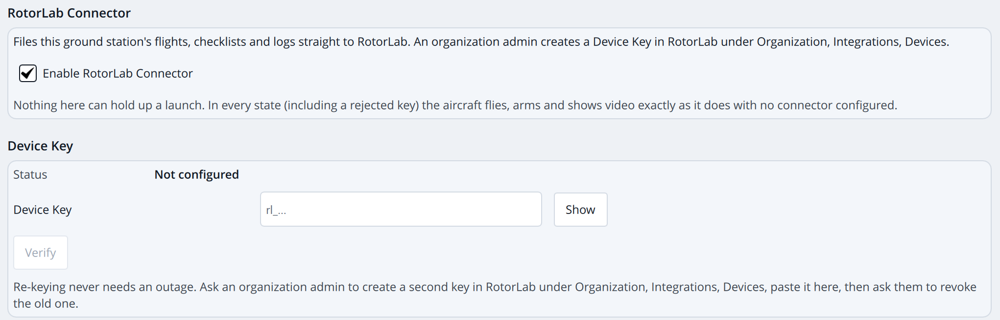
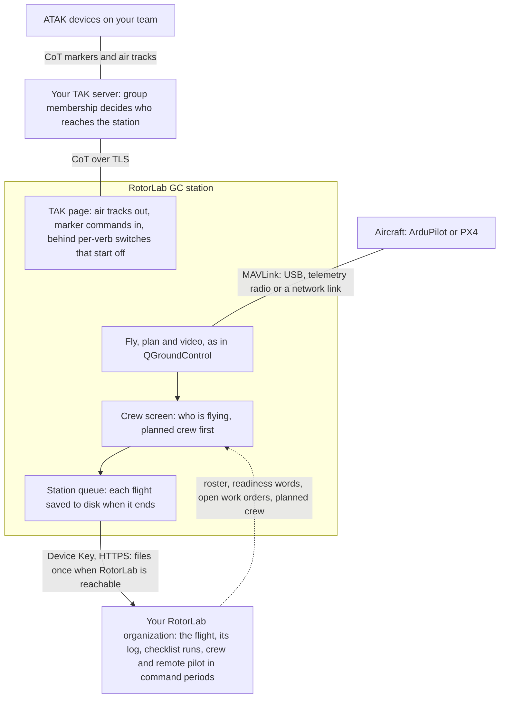

<p align="center">
  
</p>

<p align="center">
  <a href="https://github.com/RotorLabApp/RotorLabGC/releases/latest"></a>
  <a href="COPYING.md"></a>
  <a href="docs/compatibility.md"></a>
  <a href="docs/compatibility.md"></a>
  <a href="https://qgroundcontrol.com/"></a>
  <a href="#verify-a-release"></a>
</p>

# RotorLab GC

**The ground control station that keeps the record while you fly.**

RotorLab GC is a full MAVLink ground control station for ArduPilot and PX4 aircraft, on Windows and Android. It puts your aircraft on your team's TAK map and can file each flight to RotorLab, with who was flying.

- **ATAK built in.** Your aircraft appear on the TAK map as air tracks, and commands from ATAK markers stay off until you switch on each verb.
- **Flights file to RotorLab.** With the RotorLab Connector on, each flight files when it ends, with its log, its checklist runs and its remote pilot in command.
- **Keeps flying with no network.** Flights wait in the station's queue and file once when RotorLab is reachable again.
- **Readable and verifiable.** The full source is here, releases from 5.1.1 are signed, and you can build GC yourself.

**[Get RotorLab GC](https://app.rotorlab.app/buy/gc)** | **[Quick start](#quick-start)** | **[Download](#download)** | [Verify a release](#verify-a-release) | [Docs](https://docs.rotorlab.app/) | [Contact sales](https://rotorlab.app/contact-sales/)

GC records and warns. It never authorizes a flight, and the decision to fly stays with your pilot and your organization.

## Contents

- [Who it is for](#who-it-is-for)
- [What GC adds to QGroundControl](#what-gc-adds-to-qgroundcontrol)
- [How it works with RotorLab](#how-it-works-with-rotorlab)
- [Quick start](#quick-start)
- [Open by design](#open-by-design)
- [FAQ](#faq)
- [Download](#download)
- [Verify a release](#verify-a-release)
- [Build from source](#build-from-source)
- [What this release was tested on](#what-this-release-was-tested-on)
- [License](#license)
- [Support](#support)
- More in [`docs/`](docs/): [concepts](docs/concepts.md), [setup, upgrade and uninstall](docs/setup.md), [options](docs/options.md), [troubleshooting](docs/troubleshooting.md), [FAQ](docs/faq.md), [security model](docs/security-model.md), [compatibility](docs/compatibility.md), [limits](docs/limits.md)
- Everything about ATAK and TAK: the [RotorLab GC ATAK and TAK Field Guide](https://github.com/RotorLabApp/rotorlab-gc-tak-guide)

## Who it is for

- **Public safety teams** who need the aircraft on the same TAK map as the people on the ground.
- **Enterprise fleets** who want each flight filed to RotorLab when it ends, so crews do not type it in afterward.
- **Survey and inspection teams** who plan, fly and file the same kind of mission day after day.
- **Manufacturers** who want a ground station for their MAVLink aircraft, built on QGroundControl.

## What GC adds to QGroundControl

RotorLab GC is built on QGroundControl, so planning, live telemetry, video, guided commands and vehicle setup work the way QGroundControl users expect. On top of that, GC adds the following.

### Native ATAK and TAK, with you in control

Publish your aircraft to a TAK server as air tracks, and let a map marker in ATAK send a command such as `GOTO 2 ALT 400 SPD 5`. Commands from ATAK stay behind three switches that all start off and per-verb switches you set, and every verb is off until you check it. "Send commands only from listed senders" and "Verify server certificate" are on by default, and you can set an altitude warning level.

<p align="center">
  <picture>
    <source media="(prefers-color-scheme: dark)" srcset="docs/images/gc-tak-controls-dark.png">
    
  </picture>
  <br><sub>Command By ATAK on a new station: all three switches off and no altitude warning set.</sub>
</p>

<p align="center">
  <picture>
    <source media="(prefers-color-scheme: dark)" srcset="docs/images/gc-tak-verbs-dark.png">
    
  </picture>
  <br><sub>Enabled verbs on a new station: all nine off until you check them.</sub>
</p>

Every command received is listed on the TAK page, newest first, with the verb, the sender as ATAK reported it, the aircraft, the time and the result. ARM, TKOFF (takeoff) and GOTO also show a banner over the fly view, and every event is added to a command log on the station.

GC shows what it received and what it did. It cannot verify who really sent a marker, and the TAK page says so: the control is your TAK server's group membership.

Every verb, the marker syntax, the station checks and the command log are in the [RotorLab GC ATAK and TAK Field Guide](https://github.com/RotorLabApp/rotorlab-gc-tak-guide).

### Flights that file themselves to RotorLab

Turn on the RotorLab Connector with a Device Key from your organization, and each flight files to RotorLab when it ends, with its flight log, its checklist runs and a flight type from RotorLab's own list. The connector is designed not to hold up a launch.

<p align="center">
  <picture>
    <source media="(prefers-color-scheme: dark)" srcset="docs/images/gc-rotorlab-connector-dark.png">
    
  </picture>
  <br><sub>Where you set up the RotorLab Connector in GC, shown before any key is entered.</sub>
</p>

In RotorLab, each flight sits on its aircraft's record. A flight GC files arrives there with its log, its checklist runs, its crew and its remote pilot in command periods.

### Remote pilot in command, on record

At the launch point, the crew screen shows your RotorLab roster, with the day's planned crew listed first with their duties. It shows RotorLab's own readiness words for each aircraft and any open work orders. You can change the remote pilot in command at any time, in flight too, with an optional reason. Each change is written to the station at once and filed with the flight.

The crew screen informs; it never decides. Every aircraft stays selectable, and "Start flying" is never held. GC records and warns. It never authorizes a flight, and a green state is not permission to fly.

Readiness words and work orders need RotorLab 3.5.1 or later; planned crew and remote pilot in command records need RotorLab 3.5.4 or later.

### An offline queue that files once

No network at the field? GC saves each flight to disk when the aircraft disarms and files it from its queue when RotorLab is reachable again. GC is designed to file each flight once, and not to download a log while any aircraft is armed.

### RotorLab Server connection

Join a station to a RotorLab Server (Fleet Server role) with the address and enrollment code your operator gives you, so the station reports to your own on-premises server. RotorLab Server is in early access testing and not on sale today. Running more than one crew? [Talk to us about a fleet](https://rotorlab.app/quote/).

### Settings that fit any screen

Every settings page, built-in and RotorLab's, fills the window and reflows to its width, in light and dark. The smallest window fits a laptop screen. The fly view is unchanged.

## How it works with RotorLab



1. **Your organization in RotorLab** holds your aircraft, pilots, checklists and missions. An organization admin creates a Device Key for each station under Organization, Integrations, Devices.
2. **GC at the launch point** asks who is flying, flies the mission and records the flight.
3. **RotorLab** receives the flight with its log, its crew and its remote pilot in command periods, so the record is there when you need it.

What GC sends, where and when is in [docs/security-model.md](docs/security-model.md). The ideas behind it (station, Device Key, queue, sortie, remote pilot in command periods) are in [docs/concepts.md](docs/concepts.md).

## Quick start

**You need:** a RotorLab account, Windows 10 or 11 (x64) or an Android arm64 phone or tablet, and an ArduPilot or PX4 aircraft or SITL. To file flights you also need a Device Key from an organization admin. See [docs/compatibility.md](docs/compatibility.md) for the RotorLab versions each feature needs.

1. **Get GC.** Start at [app.rotorlab.app/buy/gc](https://app.rotorlab.app/buy/gc) and download GC from your RotorLab account, or from this repository's [Releases](https://github.com/RotorLabApp/RotorLabGC/releases/latest). Check the download as described under [Verify a release](#verify-a-release).
2. **Install it and enter your license key.** Your license key is on your organization's licenses in RotorLab. Activating needs a connection to RotorLab.
3. **Connect and fly.** Connect your aircraft and fly. To file flights to RotorLab, an organization admin opens Organization, Integrations, Devices in RotorLab, names the station and clicks Enroll device, and copies the Device Key, which is shown once; then, in GC, open Application Settings, RotorLab Connector, check "Enable RotorLab Connector", paste the key and press Verify.

<p align="center">
  <picture>
    <source media="(prefers-color-scheme: dark)" srcset="docs/images/rotorlab-devices-dark.png">
    
  </picture>
  <br><sub>Where an organization admin enrolls a station and gets its Device Key, in RotorLab under Organization, Integrations, Devices. Fictional demo organization.</sub>
</p>

Step by step, with upgrade and uninstall: [docs/setup.md](docs/setup.md). The [docs](https://docs.rotorlab.app/) cover RotorLab itself, and [RotorLab Academy](https://academy.rotorlab.app/) has Part 107 test prep and hands-on RotorLab trainings for your pilots and crews.

## Open by design

We publish RotorLab GC's source because a ground station should be something you can inspect, not something you have to take on trust.

- **Built on QGroundControl,** the widely used open ground station from the Dronecode project.
- **The source of every RotorLab GC release is here** to read and audit, including the TAK command handling and the RotorLab Connector.
- **Your security team can review the source** of the GC that runs on your field laptops and tablets.
- **Signed releases from 5.1.1** that you can verify against our published key. You can also build GC yourself from the tagged source; your build will not carry our signatures or match ours byte for byte.
- **Standard MAVLink.** GC speaks standard MAVLink and is built for ArduPilot and PX4 aircraft.
- **Open source, on clear terms.** Like QGroundControl, the source is offered under the Apache License 2.0 or the GNU GPL v3, and the builds we publish are distributed under the GNU GPL v3. Under those licenses it comes without warranty; see [License](#license).
- **Credit where it is due.** We keep QGroundControl's license and credit to the QGroundControl and Dronecode community.

Where RotorLab's code is:

| Folder | What it holds |
|---|---|
| `custom/src/tak`, `custom/res/tak` | TAK and ATAK: air tracks, commands from ATAK markers, the command list, banner and command log, TAK enrollment |
| `custom/src/rotorlab`, `custom/res/rotorlab` | The RotorLab Connector: filing, the station queue, the crew screen, the remote pilot in command log, checklists and missions |
| `custom/src/fleet`, `custom/res/fleet` | The RotorLab Server (Fleet Server role) connection |
| `custom/src/license`, `custom/res/license`, `custom/src/net` | The license check, Device Key storage and network helpers |
| `src/QmlControls/RLPageLayout.qml`, `src/UI/AppSettings` | The full-window settings layout |
| `test/Custom` | Unit tests for RotorLab's features |

[NOTICE](NOTICE) lists what RotorLab changed against upstream, and the git history records every change. To check a download, see [Verify a release](#verify-a-release). To report a security issue, see [SECURITY.md](SECURITY.md).

## FAQ

**Does GC decide whether a flight may go?**
No. GC records, reminds and warns, and shows what RotorLab's records say. The decision to fly stays with your pilot and your organization.

**Do I need RotorLab to use GC?**
GC needs a license key, which comes from your RotorLab account, and activating it needs a connection to RotorLab. After that, GC opens and flies on its stored activation when it is offline, and re-checks the license every 24 hours and when the network comes back. A re-check never closes GC or interrupts a flight; the next start applies its result. The RotorLab Connector, the crew screen and the filing queue work with your RotorLab organization; flying, planning and ATAK do not need a connection to it.

**What happens when there is no network?**
GC keeps flying as normal. Flights wait in the station's queue and file when RotorLab is reachable again.

**Which aircraft does GC fly?**
MAVLink aircraft on ArduPilot or PX4: multirotor, VTOL, fixed-wing and quadplane, over USB, telemetry radio or a network link.

**Which platforms?**
Windows 10 and 11 (x64), and Android on arm64. [docs/compatibility.md](docs/compatibility.md) says what this release was tested on.

**Can I check what GC does?**
Yes. Read the source here. GC sends flights, logs and checklist runs to your RotorLab organization only when the RotorLab Connector is on, and the station keeps its own TAK command log and remote pilot in command log on disk.

More answers in [docs/faq.md](docs/faq.md).

## Download

Download RotorLab GC from your RotorLab account, starting at [app.rotorlab.app/buy/gc](https://app.rotorlab.app/buy/gc).

Signed releases are also on this repository's GitHub Releases page, starting with [RotorLab GC 5.1.1](https://github.com/RotorLabApp/RotorLabGC/releases/tag/v5.1.1). The 5.1.1 release has six files:

- `RotorLabGC-v5.1.1-windows-x64-installer.exe`: the Windows installer, Authenticode-signed by RotorLab Inc.
- `RotorLabGC-v5.1.1-android-arm64-v8a.apk`: the Android app for arm64, signed with RotorLab's Android key.
- `SHA256SUMS.txt`: the SHA-256 of the installer and the APK.
- `RotorLabGC-v5.1.1-windows-x64-installer.exe.sig`, `RotorLabGC-v5.1.1-android-arm64-v8a.apk.sig` and `SHA256SUMS.txt.sig`: a detached signature for each of those three files, made with the RotorLab release key.

The NOTICE and COPYING inside a build are the ones at that release's tag.

GC needs a license key from your RotorLab account, wherever you download it.

## Verify a release

Each signed release comes with `SHA256SUMS.txt` and a `.sig` file for `SHA256SUMS.txt`, the installer and the APK, made with the RotorLab release key. Check the signatures first, then the checksums, before you install.

### Check the signatures

You need OpenSSH 8.1 or later (`ssh-keygen` ships with Windows 10 and 11, Linux and macOS). `ssh -V` shows your version; Git for Windows includes a current one. Save RotorLab's public release key as a file named `allowed_signers`, in the same folder as the downloads. It holds no secret. In Git Bash, Linux or macOS:

```sh
echo 'release@rotorlab.app namespaces="rotorlab-release" ssh-ed25519 AAAAC3NzaC1lZDI1NTE5AAAAIM9oNOu1L0o1g6JAyIUyeb2A9/pkRwLvuQeJmey01AeJ' > allowed_signers
```

Or save this line in a text editor as `allowed_signers`:

```text
release@rotorlab.app namespaces="rotorlab-release" ssh-ed25519 AAAAC3NzaC1lZDI1NTE5AAAAIM9oNOu1L0o1g6JAyIUyeb2A9/pkRwLvuQeJmey01AeJ release@rotorlab.app
```

Its fingerprint is `SHA256:rp0unrj35IPjEQzYNrKCgpgglmBMwycOAAbxNRRG42s`. Then, in a Windows command prompt, Git Bash, or any shell on Linux or macOS, check `SHA256SUMS.txt` and each file you downloaded. For 5.1.1:

```sh
ssh-keygen -Y verify -f allowed_signers -I release@rotorlab.app -n rotorlab-release -s SHA256SUMS.txt.sig < SHA256SUMS.txt
ssh-keygen -Y verify -f allowed_signers -I release@rotorlab.app -n rotorlab-release -s RotorLabGC-v5.1.1-windows-x64-installer.exe.sig < RotorLabGC-v5.1.1-windows-x64-installer.exe
ssh-keygen -Y verify -f allowed_signers -I release@rotorlab.app -n rotorlab-release -s RotorLabGC-v5.1.1-android-arm64-v8a.apk.sig < RotorLabGC-v5.1.1-android-arm64-v8a.apk
```

Each command must print:

```text
Good "rotorlab-release" signature for release@rotorlab.app with ED25519 key SHA256:rp0unrj35IPjEQzYNrKCgpgglmBMwycOAAbxNRRG42s
```

PowerShell has no `<` redirect, so use a command prompt or Git Bash for these. Anything other than `Good` means do not install the file.

### Check the checksums

On Linux (strip any Windows line endings first):

```console
$ tr -d '\r' < SHA256SUMS.txt | sha256sum -c --ignore-missing -
RotorLabGC-v5.1.1-windows-x64-installer.exe: OK
RotorLabGC-v5.1.1-android-arm64-v8a.apk: OK
```

On Windows, in PowerShell, compare the hash with the file's line in `SHA256SUMS.txt`:

```powershell
(Get-FileHash .\RotorLabGC-v5.1.1-windows-x64-installer.exe).Hash
```

```text
5CAFD873A9C3ECE85F3D02E40C38C64694FF7BD503900F9CE0743F925C828DB6
```

On Windows, you can also check the installer's Authenticode signature: in PowerShell, `Get-AuthenticodeSignature .\RotorLabGC-v5.1.1-windows-x64-installer.exe` should show `Valid`, signed by RotorLab Inc.

## Build from source

You need:

- Qt 6.8.3 (msvc2022_64 for Windows, android_arm64_v8a for Android) with the modules listed in `CMakeLists.txt`;
- CMake 3.25 or later and Ninja;
- on Windows, Visual Studio 2022 with the C++ workload; for Android, the Android SDK, NDK 26.1.10909125 and JDK 17.

Clone with the submodule, check out the release tag you want (for example `v5.1.1`), then configure and build:

```
git clone --recurse-submodules https://github.com/RotorLabApp/RotorLabGC.git
cd RotorLabGC
git checkout v5.1.1
git submodule update --init
qt-cmake -S . -B build -G Ninja -DCMAKE_BUILD_TYPE=Release -DQGC_STABLE_BUILD=ON
cmake --build build
```

`deploy/rotorlab/release.ps1` is the script we build releases with. It states every CMake option a release uses, builds from a clean checkout of a tag, and checks that the version in the built files matches the tag. Its parameters name the Qt, Visual Studio, Ninja and Android folders on your machine.

A build you make yourself is not byte-identical to our signed release and carries no RotorLab signature; it lets you read, compile and test the same source.

## What this release was tested on

For 5.1.1, on Windows 11 (x64):

- the release was built from the `v5.1.1` tag with `deploy/rotorlab/release.ps1`, and the test suites passed: 121 passed, 0 failed, 5 skipped;
- the three signatures and both checksums of the published files were checked with the commands above (the output shown is from that run), and the installer's Authenticode signature reads `Valid`.

During 5.1 development, GC's license activation, flight filing, offline queue, RotorLab Server enrollment and ATAK commands were run end to end against ArduPilot Copter in SITL, a local RotorLab 3.5.6, RotorLab Server 2.0 and OpenTAKServer 1.8.3. The Device Key store on Android was tested on an Android 11 emulator.

Not run for this release: the 5.1.1 APK on an Android device, a PX4 aircraft, and Windows 10. [docs/compatibility.md](docs/compatibility.md) has the full matrix.

## License

RotorLab GC is a modified version of QGroundControl. QGroundControl is dual licensed under the [Apache License 2.0](LICENSE-APACHE) and the [GNU General Public License v3](LICENSE-GPL), and RotorLab's changes are offered under the same two licenses, at your choice. The Windows installer and Android APK we publish are built with the open-source edition of Qt, which includes modules offered only under the GPL v3, so those builds are distributed under the GNU General Public License v3. RotorLab, Inc. modified QGroundControl in 2026; this notice was last updated on 2026-11-15. The repository's own documentation and project files (README.md, CHANGELOG.md, SECURITY.md, CONTRIBUTING.md, CODE_OF_CONDUCT.md, the docs/ folder and the .github/ issue and pull request templates) were written or changed by RotorLab; the git history records every change. Upstream copyright and license notices are kept as they appear upstream. As both licenses state, the software is provided without warranty. See [COPYING.md](COPYING.md), and [NOTICE](NOTICE) for what RotorLab changed and for the third-party components and licenses a build includes. The license texts and NOTICE are in this repository. The Windows installer and Android APK of RotorLab GC 5.1.1 and later include these license texts and NOTICE (Windows: next to bin/; Android: assets/licenses/). Builds before 5.1.1 do not.

QGroundControl, Dronecode, MAVLink, ArduPilot, PX4, ATAK, TAK and OpenTAKServer are trademarks of their respective owners. Qt is a registered trademark of The Qt Company Ltd. Windows is a trademark of the Microsoft group of companies. Android is a trademark of Google LLC. RotorLab and RotorLab GC are trademarks of RotorLab, Inc. Naming these projects and products describes what GC is built on and works with. It does not imply endorsement by, or affiliation with, the QGroundControl project, the Dronecode Foundation, ArduPilot, PX4, the TAK Product Center, the U.S. Government or any other third party.

## Support

- **Account, license and billing questions:** contact RotorLab at [rotorlab.app/contact](https://rotorlab.app/contact), or [contact sales](https://rotorlab.app/contact-sales/).
- **Using GC:** [docs/](docs/) in this repository, the [RotorLab docs](https://docs.rotorlab.app/), the [ATAK and TAK Field Guide](https://github.com/RotorLabApp/rotorlab-gc-tak-guide) and [RotorLab Academy](https://academy.rotorlab.app/).
- **A bug in GC or a question:** open an issue in this repository with the bug or question template. Please leave out keys, passwords, flight logs and anything personal.
- **A security issue:** email [security@rotorlab.app](mailto:security@rotorlab.app), or use GitHub private vulnerability reporting; see [SECURITY.md](SECURITY.md). Please do not open a public issue.
- **Contributing:** see [CONTRIBUTING.md](CONTRIBUTING.md) and our [Code of Conduct](CODE_OF_CONDUCT.md).

---

<p align="center">
  <a href="https://rotorlab.app/">RotorLab</a> ·
  <a href="https://rotorlab.app/gc/">RotorLab GC</a> ·
  <a href="https://docs.rotorlab.app/">Docs</a> ·
  <a href="https://academy.rotorlab.app/">Academy</a> ·
  <a href="https://rotorlab.app/contact/">Support</a> ·
  <a href="SECURITY.md">Security</a> ·
  <a href="COPYING.md">Apache 2.0 or GPL v3</a>
  <br>
  <sub>RotorLab, Inc., Dubuque, Iowa. RotorLab records and warns; it never authorizes a flight.</sub>
</p>
