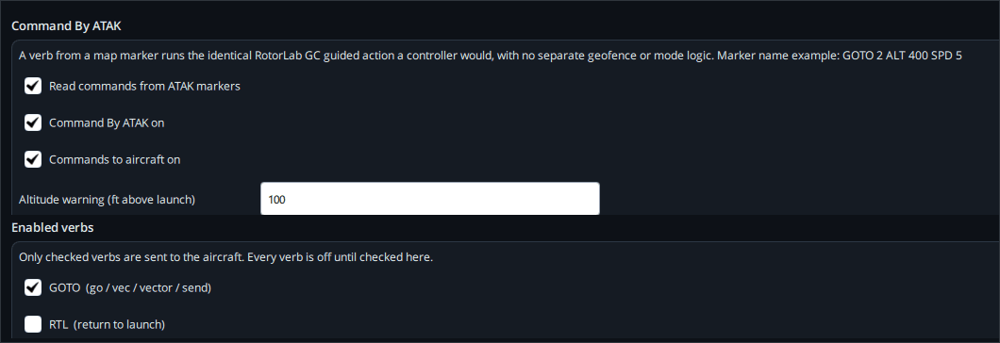
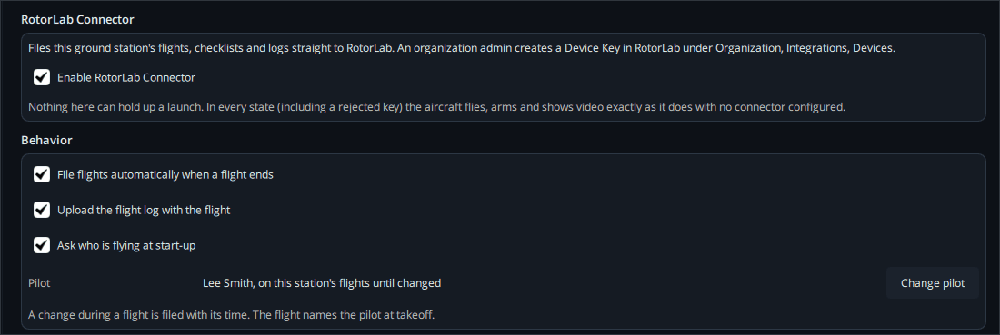
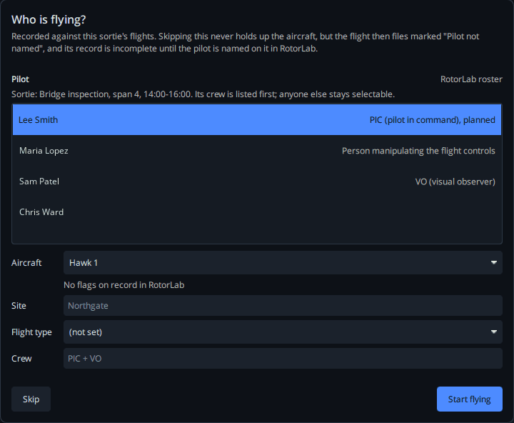
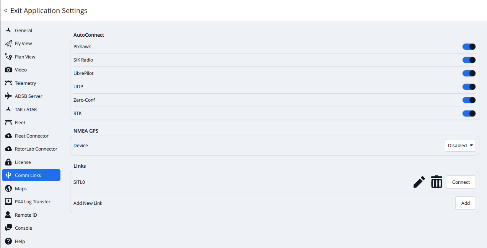

# RotorLab GC

**The ground control station that keeps the record while you fly.**

RotorLab GC is a full MAVLink ground control station for ArduPilot and PX4 aircraft, on Windows and Android. Native ATAK puts your aircraft and your ground team on one map, and GC can file each flight to RotorLab on its own, with who was flying.

**[Get RotorLab GC](https://app.rotorlab.app/buy/gc)** · [Product page](https://rotorlab.app/gc/) · [Docs](https://docs.rotorlab.app/) · [RotorLab Academy](https://academy.rotorlab.app/) · [Talk to sales](https://rotorlab.app/contact-sales/) · [RotorLab](https://rotorlab.app/)

---

## Who it is for

- **Public safety teams** who need the aircraft on the same TAK map as the people on the ground.
- **Enterprise fleets** who want every flight on record without asking crews to type it in afterward.
- **Survey and inspection teams** who plan, fly and file the same kind of mission day after day.
- **Manufacturers** who want a ground station for their MAVLink aircraft, built on QGroundControl.

## What GC adds to QGroundControl

RotorLab GC is built on QGroundControl, so planning, live telemetry, video, guided commands and vehicle setup work the way QGroundControl users expect. On top of that, GC adds the following.

### Native ATAK and TAK, with you in control

Publish your aircraft to a TAK server as air tracks, and let a map marker in ATAK send a command such as `GOTO 2 ALT 400 SPD 5`. Commands from ATAK stay behind a master switch and per-verb switches you set, and every verb is off until you check it. "Send commands only from listed senders" and "Verify server certificate" are on by default, and you can set an altitude warning level.



Every command received is listed on the TAK page, newest first, with the verb, the sender as ATAK reported it, the aircraft, the time and the result. ARM, TKOFF (takeoff) and GOTO also show a banner over the fly view, and every event is added to a command log on the station.

GC shows what it received and what it did. It cannot verify who really sent a marker, and the TAK page says so: the control is your TAK server's group membership.

### Flights that file themselves to RotorLab

Turn on the RotorLab Connector with a Device Key from your organization, and each flight files to RotorLab when it ends, with its flight log, its checklist runs and a flight type from RotorLab's own list. The connector is designed so it does not hold up a launch: in every connector state, arming, flight and video work as they do with no connector set up.



### Remote pilot in command, on record

At the launch point, the crew screen shows your RotorLab roster, with the day's planned crew listed first with their duties. It shows RotorLab's own readiness words for each aircraft and any open work orders. You can change the remote pilot in command at any time, in flight too, with an optional reason. Each change is written to the station at once and filed with the flight.



The crew screen informs; it never decides. Every aircraft stays selectable, and "Start flying" is never held. GC records and warns. It never authorizes a flight, and a green state is not permission to fly.

Readiness words and work orders need RotorLab 3.5.1 or later; planned crew and remote pilot in command records need RotorLab 3.5.4 or later.

### An offline queue that files once

No network at the field? GC saves each flight to disk when the aircraft disarms and files it from its queue when RotorLab is reachable again. GC is designed to file each flight once, and not to download a log while any aircraft is armed.

### Fleet Server connection

Join a station to a RotorLab Fleet Server with the address and code your operator gives you, so the station reports to your own on-premises server. Fleet Server is not on sale today; [talk to sales](https://rotorlab.app/contact-sales/) if you run more than one crew.

### Settings that fit any screen

Every settings page, built-in and RotorLab's, fills the window and reflows to its width, in light and dark. The smallest window fits a laptop screen. The fly view is unchanged.

<picture>
  <source media="(prefers-color-scheme: dark)" srcset="docs/images/gc-settings-dark.png">
  
</picture>

## How it works with RotorLab

1. **Your organization in RotorLab** holds your aircraft, pilots, checklists and missions. An organization admin creates a Device Key for each station under Organization, Integrations, Devices.
2. **GC at the launch point** asks who is flying, flies the mission and records the flight.
3. **RotorLab** receives the flight with its log, its crew and its remote pilot in command periods, so the record is there when you need it.

## Get started in three steps

1. **Get GC.** Start at [app.rotorlab.app/buy/gc](https://app.rotorlab.app/buy/gc) and download GC from your RotorLab account.
2. **Install it** and enter your license key.
3. **Connect and fly.** Connect your aircraft and fly. To file flights to RotorLab, add your Device Key under RotorLab Connector.

The [docs](https://docs.rotorlab.app/) walk through each step. Train your pilots and crews at [RotorLab Academy](https://academy.rotorlab.app/).

## Open by design

We publish RotorLab GC's source because a ground station should be something you can inspect, not something you have to take on trust.

- **Built on QGroundControl,** the widely used open ground station from the Dronecode project.
- **Every line of RotorLab's changes is here** to read and audit, including the TAK command handling and the RotorLab Connector.
- **Your security team can review the source** of the GC that runs on your field laptops and tablets.
- **Signed releases you can verify** against our published key. You can also build GC yourself from the tagged source; your build will not carry our signatures or match ours byte for byte.
- **No autopilot lock-in.** GC speaks standard MAVLink and works with ArduPilot and PX4 autopilots.
- **Open source, on clear terms.** Like QGroundControl, the source is offered under the Apache License 2.0 or the GNU GPL v3, and the builds we publish are distributed under the GNU GPL v3. Under those licenses it comes without warranty; see [License](#license).
- **Credit where it is due.** We keep QGroundControl's license and credit to the QGroundControl and Dronecode community.

To check a download, see [Verify a release](#verify-a-release). To report a security issue, see [SECURITY.md](SECURITY.md).

## FAQ

**Does GC decide whether a flight may go?**
No. GC records, reminds and warns, and shows what RotorLab's records say. The decision to fly stays with your pilot and your organization.

**Do I need RotorLab to use GC?**
GC needs a license key, which comes from your RotorLab account. The RotorLab Connector, the crew screen and the filing queue work with your RotorLab organization; flying, planning and ATAK work without a connection to it.

**What happens when there is no network?**
GC keeps flying as normal. Flights wait in the station's queue and file when RotorLab is reachable again.

**Which aircraft does GC fly?**
MAVLink aircraft on ArduPilot or PX4: multirotor, VTOL, fixed-wing and quadplane, over USB, telemetry radio or a network link.

**Which platforms?**
Windows 10 and 11 (x64), and Android on arm64.

**Can I check what GC does?**
Yes. Read the source here. GC sends flights, logs and checklist runs to your RotorLab organization only when the RotorLab Connector is on, and the station keeps its own TAK command log and remote pilot in command log on disk.

## Download

Download RotorLab GC from your RotorLab account, starting at [app.rotorlab.app/buy/gc](https://app.rotorlab.app/buy/gc).

Signed releases are also on this repository's GitHub Releases page, starting with [RotorLab GC 5.1.1](https://github.com/RotorLabApp/RotorLabGC/releases/tag/v5.1.1). The 5.1.1 release has six files:

- `RotorLabGC-v5.1.1-windows-x64-installer.exe`: the Windows installer, Authenticode-signed by RotorLab Inc.
- `RotorLabGC-v5.1.1-android-arm64-v8a.apk`: the Android app for arm64, signed with RotorLab's Android key.
- `SHA256SUMS.txt`: the SHA-256 of the installer and the APK.
- `RotorLabGC-v5.1.1-windows-x64-installer.exe.sig`, `RotorLabGC-v5.1.1-android-arm64-v8a.apk.sig` and `SHA256SUMS.txt.sig`: a detached signature for each of those three files, made with the RotorLab release key.

GC needs a license key from your RotorLab account, wherever you download it.

## Verify a release

Each signed release comes with `SHA256SUMS.txt` and a `.sig` file for `SHA256SUMS.txt`, the installer and the APK, made with the RotorLab release key. To verify, save this line as a file named `allowed_signers`. It is our release public key; it holds no secret:

```
release@rotorlab.app namespaces="rotorlab-release" ssh-ed25519 AAAAC3NzaC1lZDI1NTE5AAAAIM9oNOu1L0o1g6JAyIUyeb2A9/pkRwLvuQeJmey01AeJ release@rotorlab.app
```

Its fingerprint is `SHA256:rp0unrj35IPjEQzYNrKCgpgglmBMwycOAAbxNRRG42s`. Then, with OpenSSH 8.1 or later (in a Windows command prompt, or any shell on Linux or macOS), check `SHA256SUMS.txt` and each file you downloaded. For 5.1.1:

```
ssh-keygen -Y verify -f allowed_signers -I release@rotorlab.app -n rotorlab-release -s SHA256SUMS.txt.sig < SHA256SUMS.txt
ssh-keygen -Y verify -f allowed_signers -I release@rotorlab.app -n rotorlab-release -s RotorLabGC-v5.1.1-windows-x64-installer.exe.sig < RotorLabGC-v5.1.1-windows-x64-installer.exe
ssh-keygen -Y verify -f allowed_signers -I release@rotorlab.app -n rotorlab-release -s RotorLabGC-v5.1.1-android-arm64-v8a.apk.sig < RotorLabGC-v5.1.1-android-arm64-v8a.apk
```

Each must print `Good "rotorlab-release" signature for release@rotorlab.app`. Then check that each file's SHA-256 matches its line in `SHA256SUMS.txt`: in PowerShell, `Get-FileHash <file>`; on Linux, `tr -d '\r' < SHA256SUMS.txt | sha256sum -c --ignore-missing -` (the file uses Windows line endings).

On Windows, you can also check the installer's Authenticode signature: in PowerShell, `Get-AuthenticodeSignature .\RotorLabGC-v5.1.1-windows-x64-installer.exe` should show `Valid`, signed by RotorLab Inc.

## Build from source

You need:

- Qt 6.8.3 (msvc2022_64 for Windows, android_arm64_v8a for Android) with the modules listed in `CMakeLists.txt`;
- CMake 3.25 or later and Ninja;
- on Windows, Visual Studio 2022 with the C++ workload; for Android, the Android SDK, NDK 26.1.10909125 and JDK 17.

Clone with the submodule, check out the release tag you want (for example `v5.1.1`), then configure and build:

```
git clone --recurse-submodules https://github.com/RotorLabApp/RotorLabGC.git
cd RotorLabGC
git checkout v5.1.1
git submodule update --init
qt-cmake -S . -B build -G Ninja -DCMAKE_BUILD_TYPE=Release -DQGC_STABLE_BUILD=ON
cmake --build build
```

`deploy/rotorlab/release.ps1` is the script we build releases with. It states every CMake option a release uses, builds from a clean checkout of a tag, and checks that the version in the built files matches the tag. Its parameters name the Qt, Visual Studio, Ninja and Android folders on your machine.

A build you make yourself is not byte-identical to our signed release and carries no RotorLab signature; it lets you read, compile and test the same source.

## License

RotorLab GC is a modified version of QGroundControl. QGroundControl is dual licensed under the [Apache License 2.0](LICENSE-APACHE) and the [GNU General Public License v3](LICENSE-GPL), and RotorLab's changes are offered under the same two licenses, at your choice. The Windows installer and Android APK we publish are built with the open-source edition of Qt, which includes modules offered only under the GPL v3, so those builds are distributed under the GNU General Public License v3. RotorLab Inc modified QGroundControl in 2026; this notice was last updated on 2026-11-15. The repository's own documentation files (README.md, SECURITY.md, CONTRIBUTING.md and docs/images/) also differ from upstream; the git history records every change. Upstream copyright and license notices are kept as they appear upstream. As both licenses state, the software is provided without warranty. See [COPYING.md](COPYING.md), and [NOTICE](NOTICE) for what RotorLab changed and for the third-party components and licenses a build includes. The license texts and NOTICE are in this repository. The Windows installer and Android APK of RotorLab GC 5.1.1 and later include these license texts and NOTICE (Windows: next to bin/; Android: assets/licenses/). Builds before 5.1.1 do not.

QGroundControl and Dronecode are trademarks of their respective owners, as are ArduPilot, PX4, ATAK and TAK. RotorLab and RotorLab GC are trademarks of RotorLab Inc. Naming these projects and products describes what GC is built on and works with. It does not imply endorsement by, or affiliation with, the QGroundControl project, the Dronecode Foundation, ArduPilot, PX4, the TAK Product Center or any other third party.

## Support

- **Account, license and billing questions:** [support@rotorlab.app](mailto:support@rotorlab.app), or [talk to sales](https://rotorlab.app/contact-sales/).
- **Using GC:** the [docs](https://docs.rotorlab.app/) and [RotorLab Academy](https://academy.rotorlab.app/).
- **A bug in GC:** open an issue in this repository. Please leave out keys, passwords, flight logs and anything personal.
- **A security issue:** email [security@rotorlab.app](mailto:security@rotorlab.app); see [SECURITY.md](SECURITY.md). Please do not open a public issue.
