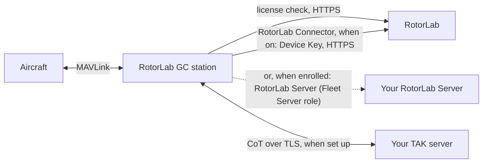

# Concepts

The words GC uses, and how the pieces fit. Everything on this page describes RotorLab GC 5.1.1 and can be checked in this repository's source (the folders are named in the [README](../README.md#open-by-design)).

## GC is QGroundControl, plus RotorLab's features

RotorLab GC is QGroundControl with RotorLab's features added. Flying, planning, guided commands, vehicle setup and the MAVLink connection work as they do in QGroundControl. RotorLab's features sit on top: TAK and ATAK, the RotorLab Connector, the crew screen, the station queue, the RotorLab Server connection, the license check and the full-window settings layout.

GC records and warns. It never authorizes a flight. Nothing GC shows (a readiness word, a currency warning, a green state) is permission to fly, and nothing in RotorLab's features holds up arming or a launch.

## Station

A **station** is one install of GC on one computer, phone or tablet. Each station has its own license activation, its own Device Key, its own queue and its own logs on disk.

## License key

GC needs a **license key** from your RotorLab account to open. A key is activated on one install at a time. Activating needs a connection to RotorLab; after that, GC opens on its stored activation when it is offline and re-checks the license every 24 hours and when the network comes back. A re-check while GC is running never closes it or interrupts a flight; the next start applies its result. See [options](options.md#license).

## Device Key

A **Device Key** lets one station file to your RotorLab organization. An organization admin creates it in RotorLab under Organization, Integrations, Devices. Device Keys begin with `rl_`. GC keeps the key in the platform's key store (Windows Credential Manager, or the Android Keystore), and never touches the key store while an aircraft is armed. A license key and a Device Key are different things: the license key lets GC open, and the Device Key lets the station file.

## RotorLab Connector

The **RotorLab Connector** is the part of GC that talks to your RotorLab organization. It is off until you turn it on. When it is on, it:

- files each flight when it ends, with its log, its checklist runs, its flight type and who was flying;
- brings your roster, the day's planned crew, readiness words and open work orders to the crew screen;
- offers your organization's published pre-flight and post-flight checklists;
- lists missions planned in RotorLab so you can open them as an ordinary plan. Nothing is sent back to RotorLab from a plan.

## Station queue

The **queue** ("Waiting to file" on the RotorLab Connector page) holds everything the station has recorded and not yet filed. A record is written to disk before the first attempt to send it, so closing the computer or a power loss after that point does not remove it. Items are retried on their own (after 1 second, 5 seconds, 30 seconds, 2 minutes, 10 minutes, then every 10 minutes), and you can press "Retry now". Each flight is filed under one reference, so a retry is designed not to file it twice. An item that cannot be sent as it is (for example, a log larger than RotorLab takes) "needs attention" and says why. Flying is never held up by the queue.

## Flight logs

After a flight, GC collects the aircraft's own log and files it with the flight, when "Upload the flight log with the flight" is on. GC does not download a log while any aircraft is armed: a log download floods a link another aircraft may be flying on. It waits until every aircraft has disarmed.

## Crew screen, sortie and remote pilot in command

The **crew screen** ("Who is flying?") opens at start-up when "Ask who is flying at start-up" is on, and at any time from "Change remote pilot in command" on the RotorLab Connector page. It lists your RotorLab roster. With RotorLab 3.5.4 or later, a **sortie** planned in RotorLab for the aircraft puts its crew first, with their duties; anyone else stays selectable.

The pilot you set is the **remote pilot in command** on the station's flights until you change it. You can change it at any time, in flight too, with an optional reason. Each change is written to a log on the station at once. With RotorLab 3.5.4 or later, a change during a flight is filed as **remote pilot in command periods** with their times; an older RotorLab records one pilot per flight, the pilot at takeoff. (GC uses the term your organization's regime uses, so the button can read "Change remote pilot in command", "Change remote pilot" or "Change pilot".)

You can skip the crew screen and fly. The flight is still recorded; with RotorLab 3.5.2 or later it files marked "Pilot not named", and its record is incomplete until the pilot is named on it in RotorLab.

## Readiness words and work orders

The crew screen shows RotorLab's own words for each aircraft (for example "Limits on record", "Condition unknown" or "No go") and any open work orders, so the crew sees what the records say. They inform; they never decide. Every aircraft stays selectable, and "Start flying" is never held.

## TAK and ATAK

GC publishes each connected aircraft to your TAK server as a Cursor on Target air track, and can act on ATAK map markers named like `GOTO ALPHA-2 ALT 400 SPD 5` (from 5.4.0 a marker names the station and the aircraft), but only the verbs the station has switched on, and only while its three Command By ATAK switches are on. Every verb starts off. The [RotorLab GC ATAK and TAK Field Guide](https://github.com/RotorLabApp/rotorlab-gc-tak-guide) covers every switch, verb, check and message.

## RotorLab Server (Fleet Server role)

A station can report to a **RotorLab Server** your organization runs on its own premises, in its **Fleet Server role**, instead of filing straight to RotorLab. You enroll the station with the server's address and a one-time enrollment code from its console. A station uses one route at a time: while the RotorLab Connector is on, the "Fleet Connector" page is hidden, and switching to the direct connector pauses reporting to the server and keeps the enrollment. RotorLab Server is in early access testing and not on sale today.

## How it fits together

What each connection carries is in the [security model](security-model.md).
