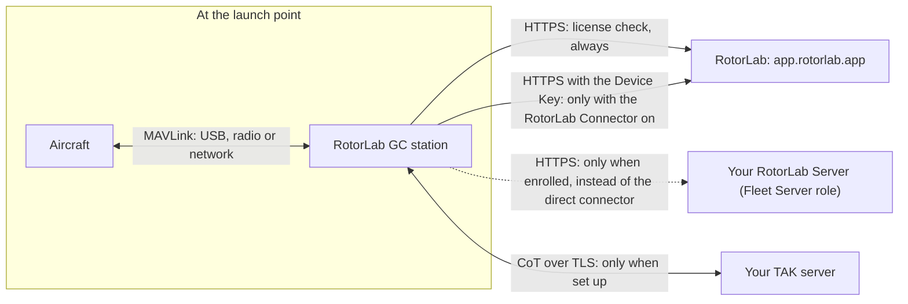

# Security model

What RotorLab GC 5.1.1 sends, where, and when; what it keeps on the station; what it trusts; and what it cannot protect you from. Where a statement names a file, you can check it in this repository's source.

## The pieces and who talks to whom

## What GC sends, where and when

| Connection | When | What | Source |
|---|---|---|---|
| RotorLab, `https://app.rotorlab.app` | At activation, at start-up, every 24 hours and when the network comes back | The license key and this install's random device id, plus the operating system name at activation, to activate, re-check or deactivate the license | `custom/src/license/LicenseManager.cc` |
| RotorLab, `https://app.rotorlab.app` | Only while "Enable RotorLab Connector" is on | With the Device Key: each flight when it ends (aircraft, takeoff and landing times, duration, a position for the flight, site, maximum height and distance, flight type, crew, who was flying and remote pilot in command periods, the operation fields you set), its flight log when "Upload the flight log with the flight" is on, and checklist runs. GC also fetches your roster, planned crew, readiness, open work orders, checklists and missions. | `custom/src/rotorlab/` |
| Your RotorLab Server | Only when the station is enrolled on the Fleet Connector page, and the RotorLab Connector is off | Telemetry, flight details, checklists and logs, as the Fleet Connector page says | `custom/src/fleet/` |
| Your TAK server | Only when set up on the TAK / ATAK page | Your aircraft as Cursor on Target air tracks; markers in | `custom/src/tak/` |
| QGroundControl's own services | When you use those features | For example, map tiles from the map provider you choose, as in QGroundControl | upstream `src/` |

In a stable (release) build, the RotorLab address is fixed at `https://app.rotorlab.app`: no environment variable, settings file or hand edit changes it (`custom/src/rotorlab/RotorLabStore.cc`).

GC never sends whether anyone was overflown or whether dangerous goods were carried.

## Keys and where they live

- **Device Key.** Kept in the platform's key store: Windows Credential Manager on Windows, and on Android a value encrypted with a key held in the Android Keystore. If the key store refuses the key, GC does not save it anywhere less safe (`custom/src/rotorlab/Credential.cc`, `RotorLabConnector.cc`). GC never touches the key store while an aircraft is armed. The key travels only to RotorLab over HTTPS. "Disconnect" removes it from the station; revoking it is done in RotorLab, under Organization, Integrations, Devices.
- **License key.** Stored on the station with its activation so GC can open offline. The stored activation ties the key to this install.
- **RotorLab Server enrollment.** An enrollment code works once and expires after 15 minutes. A code with a pin after a dot makes GC check the server's TLS key against the pin before it sends anything, and requires an `https://` address (`custom/src/fleet/FleetConnector.cc`).
- **TAK certificates.** See the [ATAK and TAK Field Guide](https://github.com/RotorLabApp/rotorlab-gc-tak-guide), chapter 2. "Verify server certificate" is on by default. Unlike the Device Key, the TAK password and client key are stored unencrypted on the station (guide, chapter 9), so protect the station's account and disk, and have the certificate revoked if a station is lost.

## What stays on the station

- **The queue.** Each flight, log and checklist run is written to disk before the first attempt to send it, and stays until RotorLab confirms it or you discard it.
- **The remote pilot in command log.** Each change of pilot, with its time and optional reason, written at once, one file per day.
- **The TAK command log.** Every command received from ATAK and what GC did with it. The guide's chapter 7 explains its hash chain and what it does and does not prove.

On Windows these live in GC's data folder under `%APPDATA%\RotorLab`. Anyone with access to the station's user account can read them.

## How RotorLab's features stay out of the way of flying

- GC records and warns. It never authorizes a flight, and nothing in RotorLab's features holds up arming, a launch or video.
- GC does not download a flight log while any aircraft is armed, and a Fleet Server log download stops at once if the aircraft arms.
- Every ATAK command verb starts off, behind three switches that all start off, and "Send commands only from listed senders" starts on. See the [ATAK and TAK Field Guide](https://github.com/RotorLabApp/rotorlab-gc-tak-guide), chapter 5.
- A license re-check while GC is running never closes it or interrupts a flight.

## What GC cannot protect you from

- **Who sent an ATAK marker.** A sender's callsign and device UID are self-reported. The sender list narrows who is heard; it does not prove who sent a marker. Your TAK server's group membership is the control on who can reach the station.
- **A compromised station.** Someone with control of the station's user account can read its local records, use its Device Key while it is stored, and fly its aircraft. Protect the computer or device as you would any flight-critical equipment.
- **The MAVLink link itself.** GC uses the link as QGroundControl does. Securing the radio or network link to the aircraft is up to your setup.
- **A green state.** Readiness words and currency are RotorLab's records, shown as they are. They are not a check that the aircraft or crew is fit to fly.

## Reporting a problem

Email [security@rotorlab.app](mailto:security@rotorlab.app), or use GitHub private vulnerability reporting from this repository's Security tab. See [SECURITY.md](../SECURITY.md).
